# Stoop

A one-screen SwiftUI and MapKit app. Friends see each other move on a map (friends only, never strangers), and everyone rates the places they tap: stars, a short review, and photos of the place and its menu. Requires iOS 18 or later. The backend is the separate [`place-rating-api`](https://github.com/CompleteGlory/Stoop-api) repository (NestJS, PostGIS, Redis).

<p align="center">
  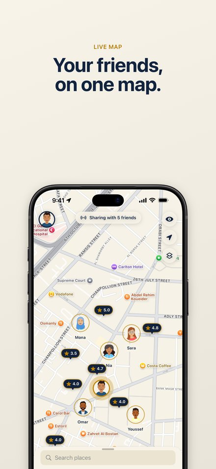
  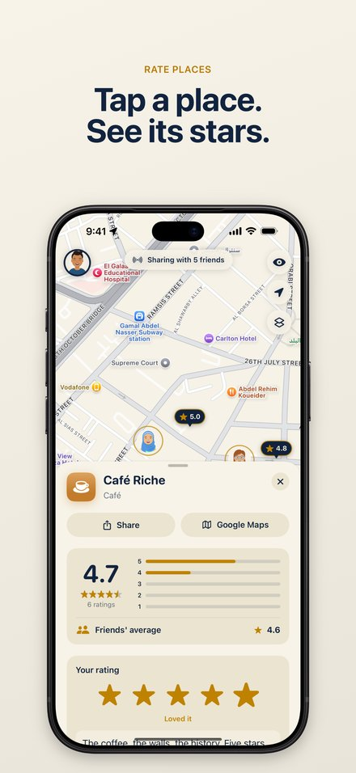
  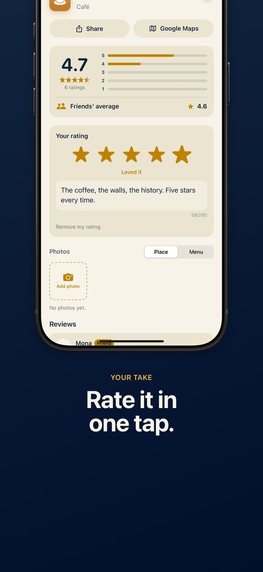
  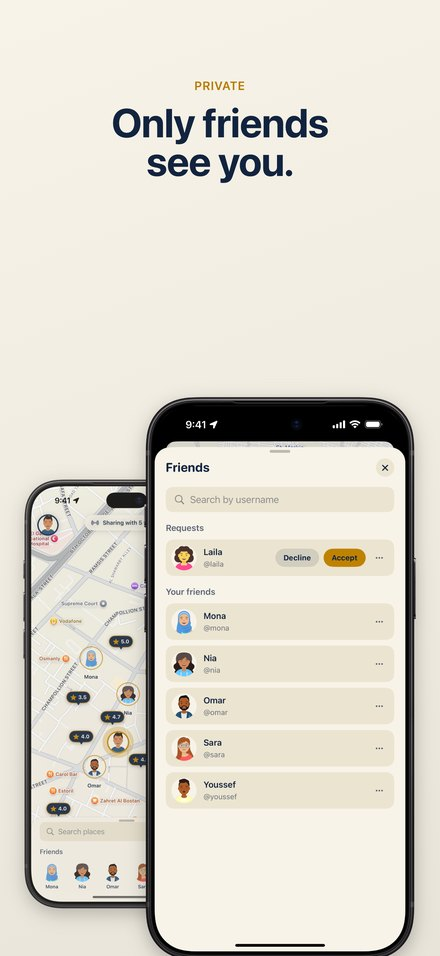
  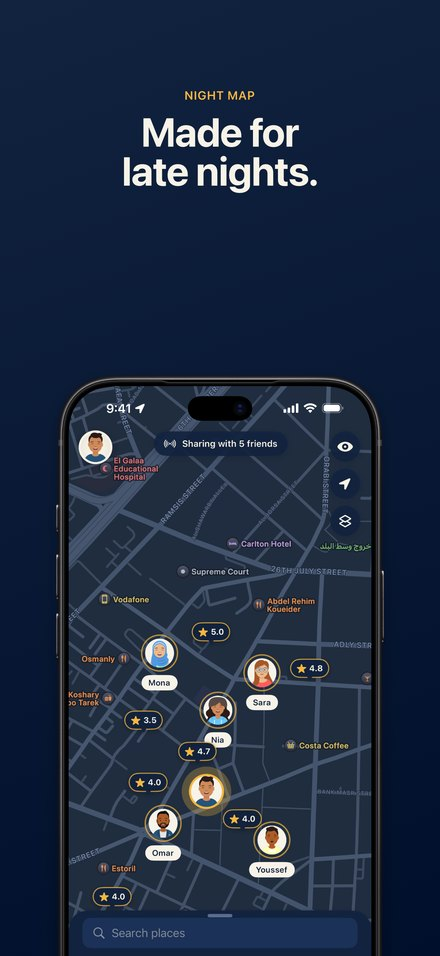
  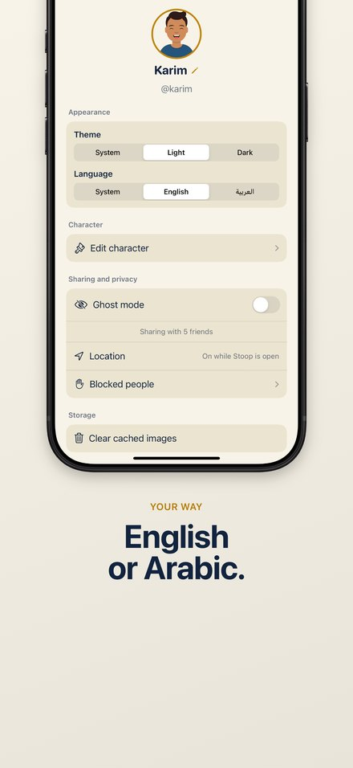
</p>

<details>
<summary>In Arabic</summary>

<p align="center">
  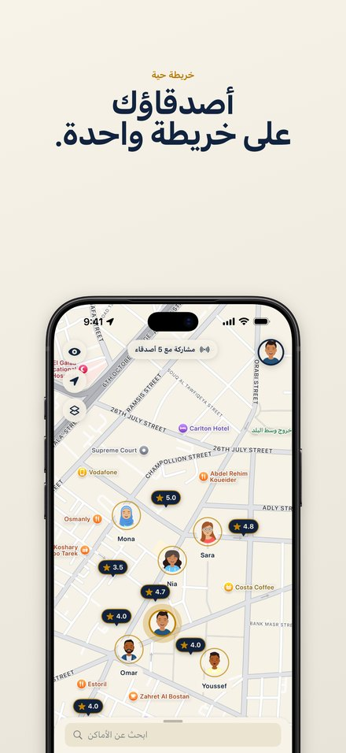
  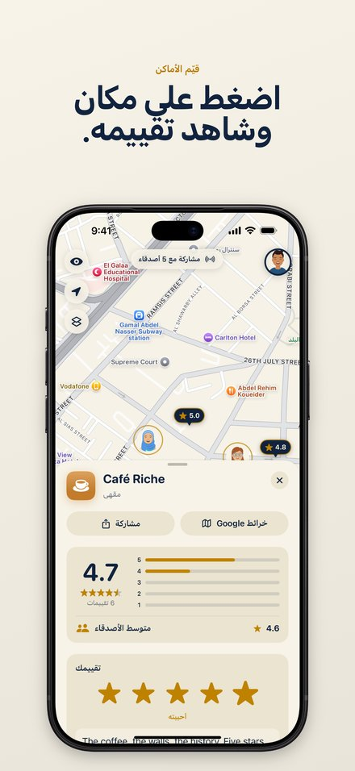
  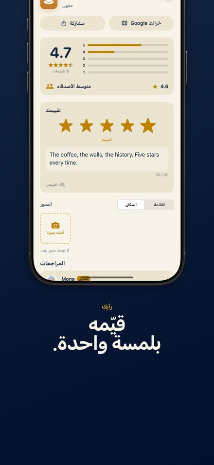
  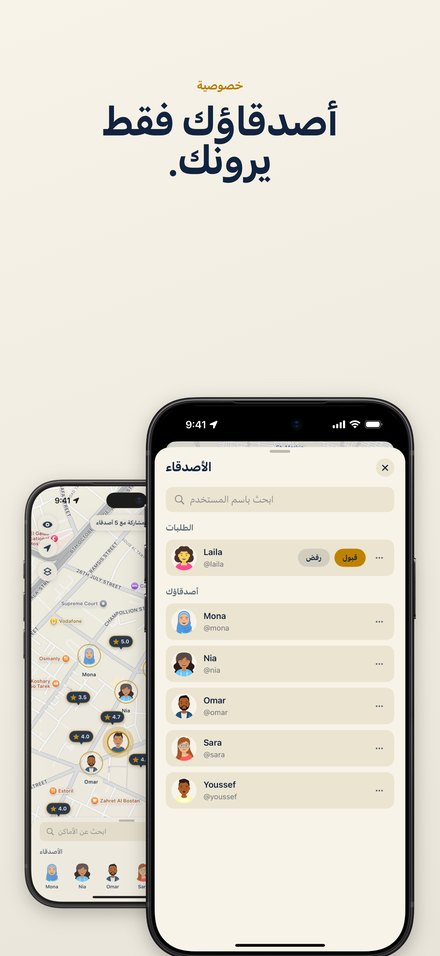
  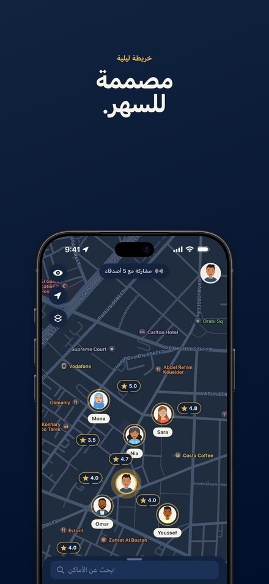
  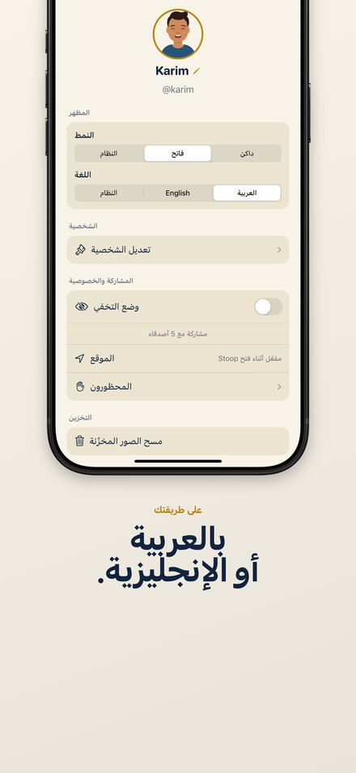
</p>

</details>

The screenshots are real captures of the app against demo data, laid out with the editor in [`marketing/screenshots`](marketing/screenshots) (see its section below).

## What it does

- **Sign in** with Apple, Google, or email and password, then pick a username and a DiceBear character.
- **Live map.** Accepted friends appear as their characters and move as they move. Ghost mode hides you. The server keeps a position for 60 seconds and never stores it.
- **Rate any place** by tapping it on the map or finding it with search. Stars save on tap, and the review saves when you finish typing. Friends' reviews come first.
- **Photos** of the place and its menu, from the camera or the library. Save anyone's photo to your library, or share it.
- **Share a place** with a link that opens its sheet in Stoop. Without the app, the link opens a web page with Google Maps and Apple Maps links. Each place also has an Open in Google Maps button.
- **Safety.** Report people, reviews and photos. Block people, which hides both of you from each other everywhere.
- **Settings.** Light, dark or system appearance; English or Arabic (right to left) without restarting; your character; ghost mode; account deletion. Nine map themes are picked on the map itself.

## Architecture

The views are small and hold no logic. Each screen has an `@Observable` view model on the main actor. Every outside dependency sits behind a protocol, so the tests swap in fakes: the network, location, the live socket, the photo library and Apple Maps search.

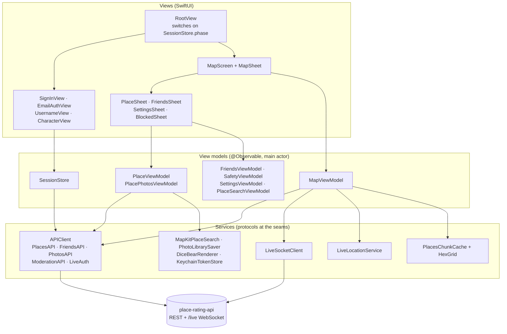

## Data flow by section

### Sign-in and onboarding

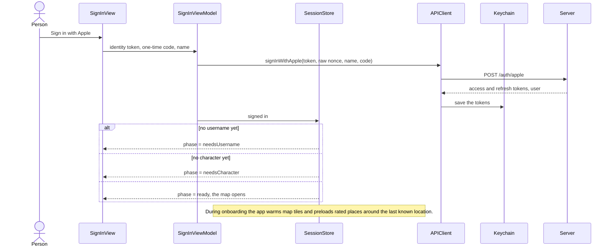

Email sign-up checks the username as you type (`GET /users/availability`, which needs no sign-in) and shows a password strength bar. Google sign-in sends Google's ID token to `POST /auth/google`. On a 401, `AuthSession` refreshes the tokens once and retries. If that fails too, the app goes back to sign-in.

### Map and live location

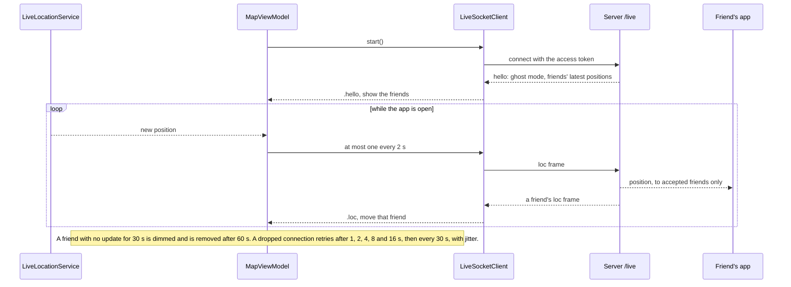

### Places and ratings

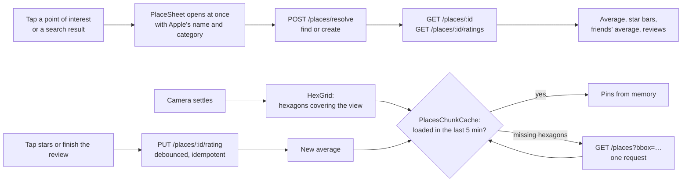

Standing still for 20 seconds preloads a wider ring of hexagons, so nearby places open with their ratings already there.

### Photos

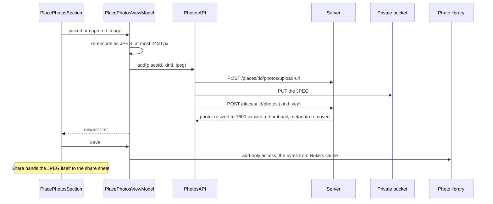

### Friends

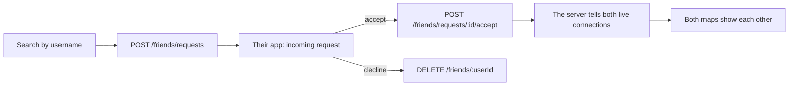

### Safety

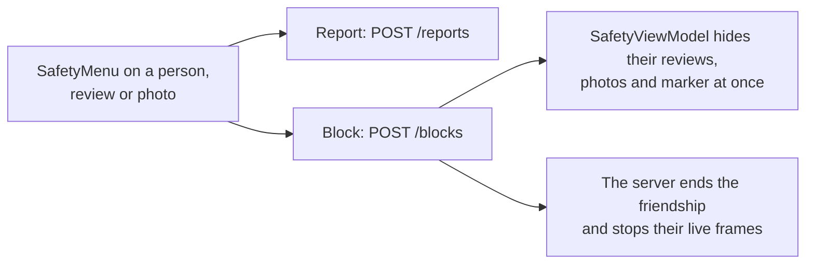

### Settings and account deletion

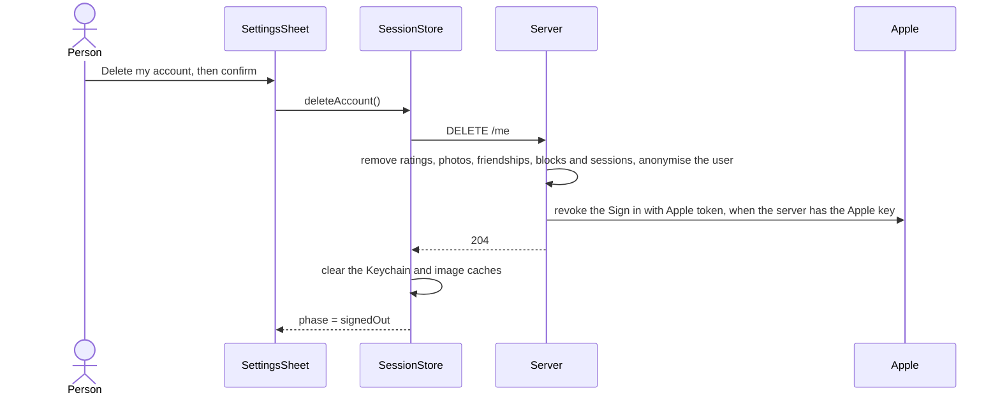

Appearance, language and map theme are kept on the device (`AppSettings`, in `UserDefaults`) and apply at once.

### Shared place links

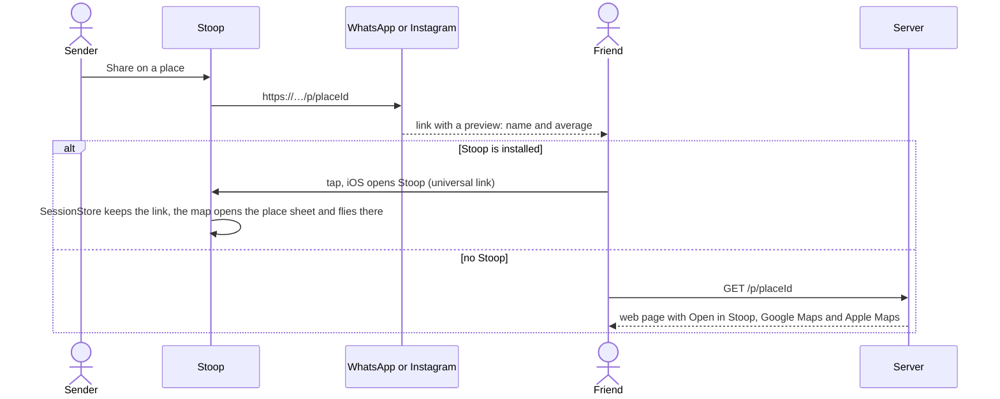

## Classes and models

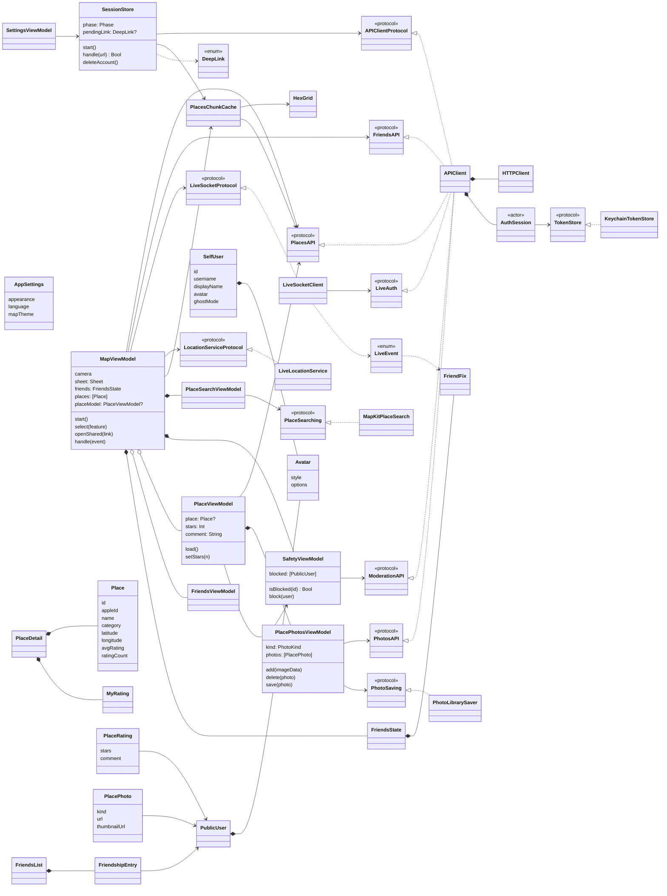

## Run it

Start the backend locally (see its `CLAUDE.md`), then open `PlaceRating.xcodeproj` and run the `PlaceRating` scheme. Debug builds talk to `http://localhost:3000` (you can switch to production on the sign-in screen). Release builds always use production.

`project.yml` is the source of truth for project settings. After changing it or adding files, regenerate the project:

```bash
xcodegen generate
```

User-facing strings live in `tools/strings/make_strings.py` with their Arabic translations. After adding one, regenerate the String Catalogs:

```bash
python3 tools/strings/make_strings.py PlaceRating/Resources
```

## Releasing

Every push to `main` runs `.github/workflows/testflight.yml`: the tests on a simulator, then a Release archive with a new build number (the UTC date and time), uploaded to TestFlight. Signing is automatic, with an App Store Connect API key in the repository secrets `APP_STORE_CONNECT_KEY_ID`, `APP_STORE_CONNECT_ISSUER_ID` and `APP_STORE_CONNECT_KEY` (the `.p8` contents). The key needs the Admin role, so Xcode can create the distribution certificate and profile itself. Google sign-in in those builds needs the repository variables `GOOGLE_CLIENT_ID` and `GOOGLE_REVERSED_CLIENT_ID`. The version shown in the App Store is `MARKETING_VERSION` in `project.yml`.

## Screenshots

`marketing/screenshots` is the App Store screenshot editor from the [app-store-screenshots](https://github.com/ParthJadhav/app-store-screenshots) skill, with Stoop's deck in `app-store-screenshots.json` and the raw captures under `public/screenshots/apple/iphone/{en,ar}/`. To change the copy or layout, run it and press **Export bundle** for every App Store iPhone size in both languages:

```bash
pnpm --dir marketing/screenshots install
```

```bash
pnpm --dir marketing/screenshots exec next dev --port 3100
```

To retake the captures, run the API locally with demo data and launch a Debug build with the screenshot options in `PlaceRating/Debug/ScreenshotRun.swift` (they sign in, open a place or sheet, and frame the map without tapping). Apple's device bezels are not in git: copy `public/frames/` from the skill's template if you want them instead of the editor's drawn frames.

## Tests

Swift Testing, with a fake for every protocol above (`PlaceRatingTests/Support.swift`). Run them in Xcode with ⌘U, or:

```bash
xcodebuild test -project PlaceRating.xcodeproj -scheme PlaceRating -destination 'platform=iOS Simulator,name=iPhone 16 Pro'
```

## Layout

```text
PlaceRating/
  App/        entry point, RootView, SessionStore, settings, brand colours
  Features/   Onboarding, Map, Place, Friends, Search, Safety, Settings: a view and its view model each
  Models/     Codable types matching the API
  Services/   API client, auth session, live socket, location, hexagon cache, links, photo saving
  Resources/  String Catalogs (English and Arabic), assets
PlaceRatingTests/
docs/app-store.md   App Store listing, privacy answers and review notes
```

## Privacy

Location is shared only while the app is open and only with accepted friends. The server keeps a position for 60 seconds and never writes it to a database. Photos are re-encoded on the server, which removes their location metadata. The privacy manifest is `PlaceRating/PrivacyInfo.xcprivacy`, and the API serves the privacy policy at `/privacy`.
